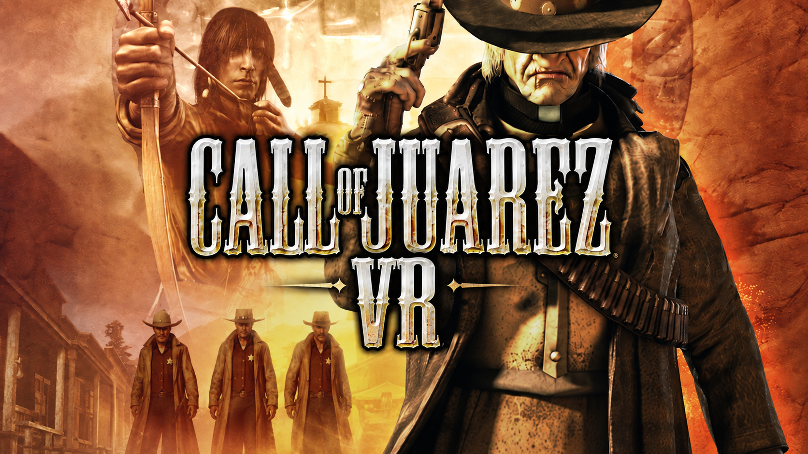

  

  
  
  
  

  

  <strong>Step into the Wild West.</strong> 
  The original <em>Call of Juarez (2006)</em>, rebuilt for stereoscopic VR, 
  tracked hands, physical combat and motion-controller interaction.

  <a href="https://github.com/rubocopter/call_of_juarez_vr/releases"><strong>Download the VR mod →</strong></a>
  &nbsp;·&nbsp;
  <a href="#install">Install</a>
  &nbsp;·&nbsp;
  <a href="#current-progress">Progress</a>
  &nbsp;·&nbsp;
  <a href="#limitations">Limitations</a>
  &nbsp;·&nbsp;
  <a href="docs/README.md">Technical docs</a>

> [!IMPORTANT]
> **Experimental pre-alpha.** The original Steam **Call of Juarez (2006), D3D9** is the reference game. Only the exact tested GOG build is admitted experimentally; other or modified binaries fail closed. **PS VR2 Sense via SteamVR** has scoped physical validation. Neither the full campaign nor other headsets are certified. Back up your saves.

## Current progress

The playable core is already in place. In exercised PS VR2 scenes it includes:

- **Native stereo and tracked movement:** two game-rendered eyes, head tracking, recenter, crouch, smooth/snap turning, a native torso and legs, and independently tracked hands.
- **Motion-controlled combat:** independent pistol aiming and dual wielding, virtual holsters, two-hand long guns, physical bow drawing/firing, melee, and encountered special weapons.
- **Interactions and presentation:** controller-driven menus, equipment wheel, HUD and subtitles, environmental interactions, native story sequences, and VR-specific options.
- **Manual firearm loading:** physical ammunition gestures with native ammo accounting. Individual revolver, base Schofield clip and Winchester operations have **limited, scene-specific** positive feedback; the wider weapon roster remains experimental.

The **development source** is ahead of the latest published player ZIP: it contains 16 exact manual firearm profiles, provisional insertion guides, more refined movie/hand recovery, native desktop output restoration and experimental color/depth/optics capture for future reconstruction. The DLAA/DLSS backend works in isolated tests and offline game samples; **gameplay still renders natively**. None of these newer changes implies headset acceptance or a newer public release.

## Install

**[Download v0.1.0-prealpha.7 for Windows](https://github.com/rubocopter/call_of_juarez_vr/releases/download/v0.1.0-prealpha.7/CoJ-VR-0.1.0-prealpha.7-windows-x64.zip)** · [Published release and checksums](https://github.com/rubocopter/call_of_juarez_vr/releases/tag/v0.1.0-prealpha.7)

Requires Windows 10/11 x64, the original supported game build, a PCVR headset, SteamVR, and D3D9 game mode. The player ZIP includes the installer and its dependencies; **the game is not included**.

1. Back up your saves and run the original game once in **D3D9**, then close it.
2. Extract the **release ZIP** (not GitHub's source ZIP) and open **CoJ-VR.cmd**.
3. Select the game directory and **Install / update**. Start SteamVR manually first if using Auto/percentage startup resolution.
4. Launch the game manually in **D3D9**. For subsequent sessions use **Prepare play session** in the launcher.

The installer provides optional startup resolution profiles, a manual-reload switch under **Advanced**, diagnostics and recovery. **Virtual Desktop users must use its SteamVR route**; VDXR does not enable OpenXR in this mod. Read the [player guide](release/README.txt) included in *your downloaded package* for exact controls, installation and uninstall instructions.

### PS VR2 Sense controls

| Input | Default action |
| --- | --- |
| Left stick / L3 | Move / crouch |
| Right stick / R3 | Turn or context aim / Focus zoom |
| L2 / R2 | Left / right action or fire |
| L1 / R1 | Left-hand interaction / kick or mounted gallop |
| Square / Cross / Circle | Reload / jump / alternate fire |
| Hold Triangle | Equipment wheel |
| Create tap / hold | Objectives / recenter |
| Options | Pause / native movie skip when allowed |

For manual reload, **Square** opens/prepares an admitted weapon; grab ammunition at the hip with the free-hand trigger, bring it to the weapon and release, then close with Square. Release the support grip first. Placement and gestures vary by weapon and are still being refined. See [Sense controls](docs/research/COJ_PC_CONTROLS_AND_HUD.md#default-sense-controls) and the [full package guide](release/README.txt).

## Limitations

- **Campaign stability and recovery:** some save/chest, cinematic and tracking transitions remain unverified or have reported failures. Save regularly.
- **Physical interaction precision:** exact cartridge mouths/occlusion, finger fit during reloading, scoped shot/reticle alignment and mounted steering/comfort remain open.
- **Coverage:** many weapon variants, missions and other PCVR headsets/controllers have not been physically qualified. A Quest 3 tester has reported some working features, but this is not full compatibility validation.
- **Image quality:** native stereo is the usable path. Optional graphics filters and DLAA/DLSS integration need further headset or engineering work; no reconstruction performance gain is claimed.

See [current validation](docs/VALIDATION.md) for accepted and rejected behavior, and the [roadmap](docs/ROADMAP.md) for remaining work. A prepared developer candidate does not change published-package behavior.

## Feedback and development

[Report a bug](https://github.com/rubocopter/call_of_juarez_vr/issues/new?template=bug_report.yml) · [Compatibility report](https://github.com/rubocopter/call_of_juarez_vr/issues/new?template=compatibility_report.yml) · [Suggestions](https://github.com/rubocopter/call_of_juarez_vr/issues/new?template=suggestion.yml)

Diagnostics are local and shared only if you choose to attach a report. Review logs and remove personal information before sharing.

[Documentation index](docs/README.md) · [Architecture](docs/ARCHITECTURE.md) · [Validation](docs/VALIDATION.md) · [Roadmap](docs/ROADMAP.md) · [Release history](release/RELEASE_NOTES.md) · [Contributing / agent workflow](AGENTS.md)

## Disclaimer

Unofficial community project; not affiliated with or endorsed by Techland, Ubisoft, Valve or Sony Interactive Entertainment. Game assets are not redistributed. Original project code is [GPL-3.0-or-later](LICENSE); see [reuse and attribution](COPYRIGHT_AND_REUSE.md) and [third-party notices](release/THIRD_PARTY_NOTICES.txt).
