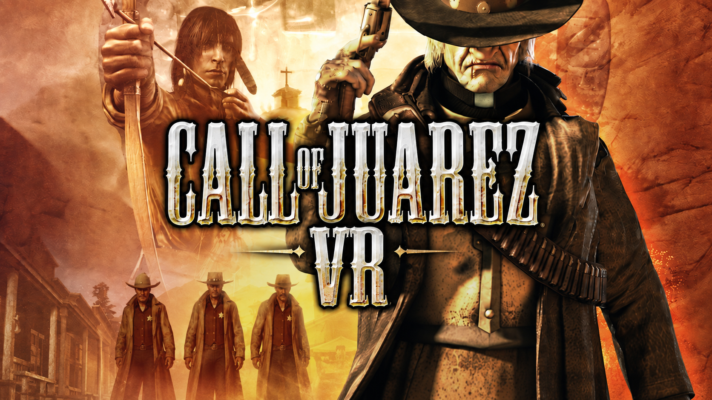
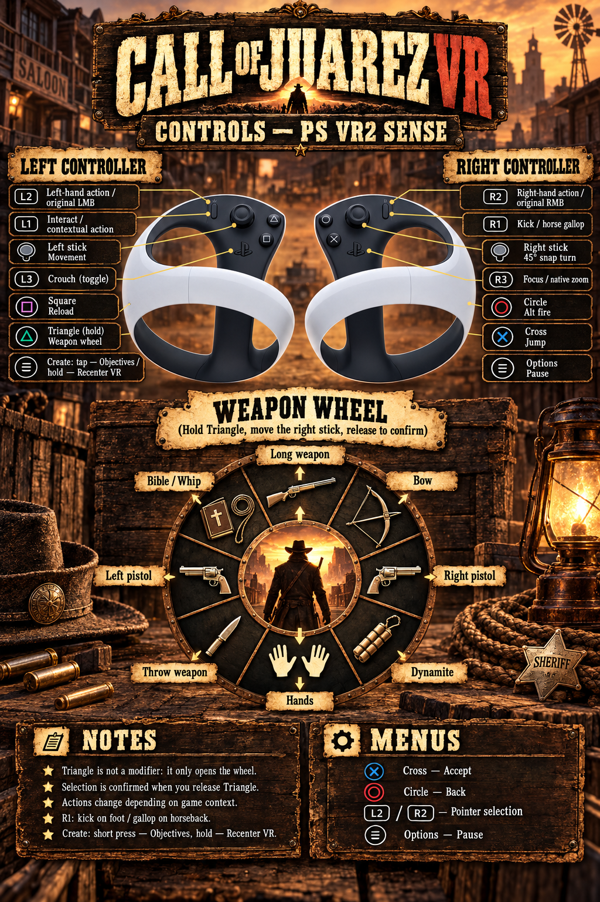

# Call of Juarez VR

<p align="center">
  
</p>

<p align="center">
  
  
  
</p>

**A native PCVR conversion of Call of Juarez (2006), built around tracked head and hands.**

> **Experimental community-testing pre-alpha.** The campaign is not fully tested, crashes can block progress, and this is not a supported release. Physical validation is limited to exercised scenes with PS VR2 Sense through SteamVR; other packaged controller bindings are experimental.

**[Download v0.1.0-prealpha.1 — Windows player ZIP](https://github.com/rubocopter/call_of_juarez_vr/releases/download/v0.1.0-prealpha.1/CoJ-VR-0.1.0-prealpha.1-windows-x64.zip)** · [Release notes and checksums](https://github.com/rubocopter/call_of_juarez_vr/releases/tag/v0.1.0-prealpha.1)

## Quickstart

You need **Windows 10/11 x64**, the **original Steam Call of Juarez (2006), D3D9 mode**, SteamVR and GPU/headset drivers. Unknown game builds are rejected. OpenXR, D3D10, Bound in Blood and Gunslinger are outside this prerelease.

1. **Back up your saves.** Run the original game in D3D9 mode once, then close it.
2. Download and extract the complete **Windows player ZIP** above. Keep its folders together; GitHub's automatic source-code ZIP is for development.
3. Double-click **CoJ-VR.cmd**, choose **1 — Install/update** and select the game folder containing `CoJ.exe`. Manual reload is optional.
4. Installation prepares the first session. Start **SteamVR**, then the **D3D9 game**, manually. Close them manually afterward.
5. Before **every subsequent play session**, with the game closed, choose **6 — Prepare session**, then start SteamVR and the game manually again.

No compiler, Git, system Python or PowerShell 7 is needed. The package bundles Python and the VC++ x86 runtime for offline installation and uses Windows PowerShell 5.1.

To update, close the game, extract a newer player ZIP and choose **1 — Install/update**; your manual-reload choice persists unless changed. Use **2 — Uninstall/recover** to restore original files and keep backups/recovery data until it succeeds. For **Access denied** in a protected game folder, run **CoJ-VR.cmd** as administrator and retry. **5 — Verify package** checks package files; it does not prepare a session. [Full package instructions](release/README.txt).

### Image quality

**Image resolution:** Native stereo renders each eye at the game's actual D3D9 target size. SteamVR supplies optics and a recommendation; changing its slider alone does not enlarge the native world render. The current development source adds [saved startup profiles](docs/research/COJ_VR_RELEASE_RESOLUTION_PROFILES.md): Preserve, Auto, 75%, 100%, 125% and Manual. Select them in the updated launcher or the local [resolution selector](tools/CoJ-VR-Resolution.cmd), with the game closed. Changes apply on session preparation, never in-session.

**Validated local reference:** Manual **2804×2860 per eye** has measured native raster/capture/output dimensions and repeated positive PS VR2 operator feedback. It is that setup's chosen default; no repeat test is pending. It is not imposed on other users: new installations default to Preserve, and other profiles remain experimental. Higher sizes can increase GPU and x86 memory pressure; recommendation equivalence, sustained timings and broad recovery remain separate [validation limits](docs/VALIDATION.md#image-quality-profile-acceptance).

**Published prerelease:** `v0.1.0-prealpha.1` is unchanged and does not include this new selector. It preserves the chosen game resolution and stages FSAA 0. With that older package, use Uninstall/recover, select a supported higher mode in the unmodded D3D9 game, then reinstall.

The internal source is the game's current color render target (**RT0**); resizing it afterward cannot recover detail the game never rendered. DSR or a similar driver option may help only if your GPU/driver exposes it **and the game actually renders at the higher selected resolution**; availability and improvement are not guaranteed.

## What you can try

These features have scoped headset validation in exercised scenes, not full campaign coverage:

- Native stereo, tracked head, recentering and room-scale movement; controller locomotion, physical crouch and snap turning.
- Independent tracked hands/weapons with the original torso and legs; exercised pistol effects, whip use and physical Hands combat.
- Controller menus, equipment wheel/haptics, wrist compass, encountered HUD/subtitles, pickup/carry, drawers and Focus.
- Optional experimental manual revolver reload: Square opens/closes, the free-hand trigger carries/inserts rounds and accepted insertions give haptic feedback. Cartridge grip and precise chamber loading remain unfinished.

## Controller guide

[](assets/CoJ_sensevr.png)

PS VR2 Sense default bindings. **Hold Options for 1 second** to open VR settings; a short tap pauses on release. Manual reload is optional: Square opens/closes, and the free-hand trigger picks up and inserts rounds. For the other experimental controller profiles, see the [controls cheat sheet](release/README.txt).

The VR settings panel is a **provisional development interface**, not the final settings experience; more comfort options are planned.

PS VR2 with Sense through SteamVR is the only physically validated reference, limited to exercised scenes. Packaged Touch, Index, Vive wand and WMR bindings are experimental and do not establish support for another headset or PC. Custom SteamVR bindings are allowed; displayed prompts still use Sense labels. [Detailed Sense controls](docs/research/COJ_PC_CONTROLS_AND_HUD.md#default-sense-controls).

## Known limitations

- Community testing of the published pre-alpha reports the view staying flat after the arrival-in-Hope cinematic. Recovery through that transition remains unvalidated; fixes under development are not included in **v0.1.0-prealpha.1**. Theater during the movie itself is intentional.
- A chest/possible-scroll interaction has caused a campaign crash. Its cause and recovery remain unresolved; progress can be lost.
- Immersive movies previously flashed the wrong image. A correction awaits headset retesting. Theater is the default; immersive movie subtitles are not transported.
- Tracking/dashboard/held-control recovery, broader death/retry and save/load, device loss and abnormal exit remain incompletely tested. Normal quit acceptance does not establish crash recovery.
- Other weapons, mounted controls, duels, climbing, special optics, sustained performance and recording compatibility need broader campaign coverage.
- Optional manual reload has scoped acceptance, but convincing cartridge grip, precise chamber loading and broader interruption recovery remain unfinished. The latest hand-directed interaction also awaits physical acceptance.

**Published package vs development:** the download above is the tagged `v0.1.0-prealpha.1` build. `main` is the development branch; local changes and subsequent fixes are not part of that ZIP until a new version is published. See [Validation](docs/VALIDATION.md) for current acceptance limits.

## Feedback

- [Reproducible bug](https://github.com/rubocopter/call_of_juarez_vr/issues/new?template=bug_report.yml): what happened, where and how to repeat it.
- [Compatibility, image quality or performance](https://github.com/rubocopter/call_of_juarez_vr/issues/new?template=compatibility_report.yml): your setup and what you observed, including successful tests.
- [Suggestion](https://github.com/rubocopter/call_of_juarez_vr/issues/new?template=suggestion.yml): what would improve your experience.

Logs are **optional**. **3 — Diagnostics** creates a local report for you to inspect and manually share; there is no automatic upload or remote telemetry. Remove private information before attaching reports, screenshots or clips. Do not share unreviewed saves or memory dumps.

## Documentation

[Validation and limits](docs/VALIDATION.md) ·
[Roadmap](docs/ROADMAP.md) ·
[Architecture](docs/ARCHITECTURE.md) ·
[Sense controls](docs/research/COJ_PC_CONTROLS_AND_HUD.md#default-sense-controls)

<details>
<summary><strong>Development</strong></summary>

Windows/x86 requires Visual Studio 2022 or Build Tools with C++ support and CMake 3.25+. Run [OpenVR bootstrap](tools/bootstrap_openvr.ps1) before configuring a fresh checkout; [OpenXR bootstrap](tools/bootstrap_openxr.ps1) supplies the optional experimental loader.

```powershell
cmake --preset win32-debug
cmake --build --preset release
ctest --preset release
```

Physical candidates use `tools/vr_test.ps1 prepare` and `finish`; add `-BodyIkAtStart -LargeAddressAware -ManualReload` for the manual-reload candidate. The operator starts/closes SteamVR and the game. Read [AGENTS.md](AGENTS.md) and the [validation workflow](docs/VALIDATION.md#evidence-policy) before integration work.

The distribution build uses `powershell -NoProfile -ExecutionPolicy Bypass -File tools/package_release.ps1 -Version 0.1.0-prealpha.1` from clean committed source. It builds/tests the isolated OpenVR Release tree and emits the player ZIP plus SHA-256 checksum. The GitHub release workflow accepts a Version through `workflow_dispatch` and prepares a draft prerelease with separate developer symbols; review it and select Publish when ready. Update `release/RELEASE_NOTES.md` for each version. Package checks do not establish additional hardware validation.

</details>

## Disclaimer

An unofficial community project, not affiliated with or endorsed by Techland, Ubisoft, Valve or Sony Interactive Entertainment. Game assets are not redistributed; the imported cartridge is [CC0](assets/models/README.md).

No project-code license has been selected. Bundled Python, OpenVR and Microsoft VC++ runtime licenses and source notices are listed in [THIRD_PARTY_NOTICES.txt](release/THIRD_PARTY_NOTICES.txt); they do not license the project code.

## Support development

If you would like to help fund development, [support the project on Ko-fi](https://ko-fi.com/onitaku).

<p align="center">
  <a href="https://ko-fi.com/onitaku"></a>
</p>
